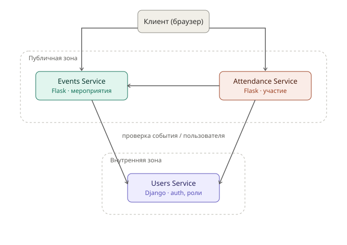

# Event Map App

Приложение-карта локальных мероприятий: пользователи находят события рядом с собой
(концерты, лекции, выставки, встречи) на карте, фильтруют по дате и категории,
отмечают участие. Организаторы публикуют события и видят отклик аудитории.

Подробнее о бизнес-задаче и user stories — в [docs/requirements.md](docs/requirements.md).

## Архитектура



Клиент публично обращается к **Events Service** и **Attendance Service**.
**Attendance Service** внутренне проверяет актуальность события в **Events Service**.
**Users Service** выдаёт JWT; Events и Attendance проверяют подпись, срок действия
и роль локально общим секретом, не храня общую сессию. Сам Users Service
находится во внутренней зоне и наружу не публикуется (кроме API аутентификации).

## Сервисы

| Сервис | Ответственность | Владеет данными | Стек | Порт |
|---|---|---|---|---|
| **events-service** | CRUD мероприятий: название, описание, локация, дата/время, категория | events, categories | Flask | 5001 |
| **attendance-service** | Отметки "пойду / интересно", счётчики участников | attendance-записи (user↔event) | Flask | 5002 |
| **users-service** | Регистрация, логин, JWT, роли (user / organizer / admin), профиль | users, roles | Django | 8000 |

**Почему такой стек:**
- **Flask** для Events и Attendance — обоим сервисам нужен простой, лёгкий CRUD/REST без
  сложной админки; Flask даёт минимум лишнего кода.
- **Django** для Users — нужна полноценная система аутентификации, хеширование паролей,
  управление пользователями и готовая админ-панель (`django.contrib.auth`, `django.contrib.admin`).

## ПР4: аутентификация, авторизация, валидация и ошибки

- **Модель пользователя**: `users-service/accounts/models.py`, миграция
  `accounts/migrations/0001_initial.py`. Поля: `username`, `email` (уникальный),
  `password` (только хэш Argon2), `role`, `date_joined` (дата регистрации).
- **Регистрация**: `POST /auth/register` — валидация логина/email/пароля, проверка
  уникальности, хэширование Argon2. Дубликат возвращает `409 Conflict`.
- **Вход**: `POST /auth/login` — принимает `username` или `email`, при ошибке `401`,
  при успехе возвращает JWT (`access_token`).
- **Защита маршрутов**: JWT Bearer проверяется в events-service и attendance-service
  (`auth.py` каждого сервиса). Изменяющие запросы без валидного токена возвращают `401`.
- **Роли**:
  - `user` — просмотр событий, отметка только своего участия;
  - `organizer` — создание событий и изменение/удаление только своих событий;
  - `admin` — любые события, просмотр пользователей и чужих отметок.
  Аутентификация (`401`) и авторизация (`403`) реализованы отдельно.
- **Единый формат ошибок** для всех сервисов:
  ```json
  {"error": {"code": "Forbidden", "message": "Доступ запрещён", "details": []}}
  ```
  Глобальные обработчики не отдают стектрейсы и приводят к этому формату
  ответы 400/401/403/404/405/409/500.
- **Документация**: [docs/auth.md](docs/auth.md) — модель, JWT, роли, защита;
  [docs/auth-check.md](docs/auth-check.md) — протокол проверки трёх сценариев доступа.

### JWT или сессия

Выбран **JWT** (HS256, срок действия 60 минут, issuer `event-map-users-service`).
Причина: сервисы разделены, и events-service/attendance-service должны проверять
пользователя без обращения к сессионному хранилищу users-service. JWT подписывается
общим секретом `JWT_SECRET`; секрет и issuer задаются переменными окружения.
Django-сессии оставлены только для админ-панели. Ограничение JWT — отзыв токена до
истечения срока не поддерживается (в токене есть `jti`, при необходимости можно
добавить blacklist).

## СРС №1: презентация

- [СРС1_Фамилия_Имя_Группа.pptx](docs/srs1/СРС1_Фамилия_Имя_Группа.pptx) — 17 слайдов, 16:9.
- [СРС1_Фамилия_Имя_Группа.pdf](docs/srs1/СРС1_Фамилия_Имя_Группа.pdf) — PDF-версия.
- [docs/security.md](docs/security.md) — анализ угроз OWASP API Top 10 и меры защиты.
- [docs/srs1/build_presentation.py](docs/srs1/build_presentation.py) — генератор презентации и диаграмм.
- [docs/srs1/README.md](docs/srs1/README.md) — что заменить перед сдачей и как пересобрать.

Перед сдачей заменить `Фамилия Имя, группа ____` на реальные данные, вставить
ссылку на Kanban, ветку и SHA последнего коммита. Пересборка:

```bash
python docs/srs1/build_presentation.py
```

## Как запустить

Общий секрет JWT должен совпадать во всех сервисах (по умолчанию
`dev-jwt-secret-change-me`; для реального окружения задайте свой `JWT_SECRET`).

### Users Service (Django)
```bash
cd users-service
pip install -r requirements.txt
cp .env.example .env              # при необходимости
python manage.py migrate
python manage.py create_admin --username admin --email admin@example.com --password 'StrongPass123'
python manage.py runserver 0.0.0.0:8000
# http://localhost:8000/health
```

### Events Service (Flask)
```bash
cd events-service
pip install -r requirements.txt
cp .env.example .env              # DATABASE_URL и JWT_SECRET
alembic upgrade head
python app.py
# http://localhost:5001
```

Контракт API: `openapi.yaml`, описание — `docs/api.md`, примеры — `docs/examples.http`.
Проверки: `python verify.py` (CRUD + JWT + роли), `verify_schema.py`, `verify_persistence.py`,
`verify_tx.py`.

### Attendance Service (Flask)
```bash
cd attendance-service
pip install -r requirements.txt
cp .env.example .env              # JWT_SECRET должен совпадать
python app.py
# http://localhost:5002
python verify.py
```

## Основные эндпоинты

| Метод | Путь | Доступ |
|---|---|---|
| POST | `/auth/register` | публично |
| POST | `/auth/login` | публично |
| GET | `/auth/me` | любой валидный JWT |
| GET | `/users` | admin |
| GET | `/users/{id}` | внутренний (users-service) |
| GET | `/events`, `/events/{id}` | публично |
| POST / PUT / PATCH / DELETE | `/events`, `/events/{id}` | organizer/admin; чужие события — только admin |
| POST | `/attendance` | любой JWT; своё участие (admin — любое) |
| GET | `/attendance/event/{id}` | публично |
| GET | `/attendance/user/{id}` | сам пользователь или admin |

## Тесты

```bash
cd users-service
python manage.py test

cd events-service
python verify.py

cd attendance-service
python verify.py
```

## Структура репозитория

```
event-map-app/
├── README.md
├── docs/
│   ├── requirements.md      ← user stories
│   ├── architecture.svg
│   ├── auth.md              ← ПР4: модель, JWT, роли, ошибки
│   ├── auth-check.md        ← ПР4: протокол проверки доступа
│   ├── security.md          ← СРС1: OWASP API Top 10
│   └── srs1/                ← СРС1: PPTX, PDF, диаграммы, генератор
├── events-service/
│   ├── app.py               ← точка входа
│   ├── api.py               ← маршруты (защита JWT)
│   ├── auth.py              ← проверка JWT/ролей
│   ├── errors.py            ← единый формат ошибок
│   ├── services.py          ← бизнес-логика и проверка владельца
│   ├── validation.py        ← валидация входных данных
│   ├── models.py, database.py, repository/
│   ├── alembic/versions/    ← миграции
│   ├── openapi.yaml         ← контракт REST API
│   ├── verify.py            ← автотест CRUD + auth
│   └── docs/                ← api.md, examples.http, db_schema.md
├── attendance-service/
│   ├── app.py               ← защита JWT
│   ├── auth.py, errors.py
│   └── verify.py
└── users-service/
    ├── manage.py
    ├── config/              ← settings, urls
    ├── accounts/            ← модель User, JWT, views, errors, middleware
    │   ├── migrations/0001_initial.py
    │   ├── management/commands/create_admin.py
    │   └── tests.py
    └── requirements.txt
```
